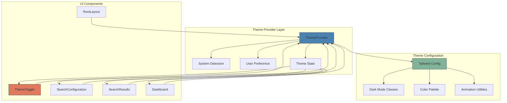

# Dark Mode Implementation Design

## Overview

This design outlines the implementation of a comprehensive dark mode feature for the Job Search Analyzer application that automatically adapts to system settings while providing users with manual control. The implementation focuses on smooth transitions, consistent theming across all components, and optimal user experience.

## Technology Stack & Dependencies

**Core Technologies:**
- Next.js 15 with App Router
- React 18.3.1 with TypeScript
- Tailwind CSS 3.4.14 for styling
- next-themes for theme management

**New Dependencies Required:**
```json
{
  "next-themes": "^0.2.1"
}
```

## Component Architecture

### Theme System Architecture



### Theme Provider Component

**Location:** `src/components/ThemeProvider.tsx`

**Component Definition:**
```typescript
interface ThemeProviderProps {
  children: React.ReactNode;
  attribute?: string;
  defaultTheme?: string;
  enableSystem?: boolean;
  disableTransitionOnChange?: boolean;
}
```

**Component Hierarchy:**
- ThemeProvider (wrapper for entire application)
  - next-themes ThemeProvider integration
  - System preference detection
  - Theme persistence in localStorage
  - Smooth transition management

### Theme Toggle Component

**Location:** `src/components/ThemeToggle.tsx`

**Component Definition:**
```typescript
interface ThemeToggleProps {
  size?: 'sm' | 'md' | 'lg';
  showLabel?: boolean;
  variant?: 'button' | 'switch' | 'dropdown';
}
```

**Component Features:**
- System/Light/Dark mode options
- Smooth icon transitions
- Keyboard accessibility
- ARIA labels for screen readers
- Visual feedback for current state

## Styling Strategy

### Tailwind CSS Configuration Enhancement

**Enhanced Color Palette:**
```javascript
// tailwind.config.js
module.exports = {
  darkMode: 'class',
  theme: {
    extend: {
      colors: {
        // Light mode colors
        background: {
          light: '#ffffff',
          dark: '#0f172a'
        },
        surface: {
          light: '#f8fafc',
          dark: '#1e293b'
        },
        border: {
          light: '#e2e8f0',
          dark: '#334155'
        },
        text: {
          primary: {
            light: '#0f172a',
            dark: '#f8fafc'
          },
          secondary: {
            light: '#64748b',
            dark: '#cbd5e1'
          }
        }
      }
    }
  }
}
```

### Global CSS Enhancements

**Dark Mode Utility Classes:**
```css
@layer components {
  .theme-transition {
    @apply transition-colors duration-300 ease-in-out;
  }
  
  .card-themed {
    @apply bg-white dark:bg-slate-800 border border-gray-200 dark:border-slate-700 theme-transition;
  }
  
  .btn-primary-themed {
    @apply bg-primary-600 hover:bg-primary-700 dark:bg-primary-500 dark:hover:bg-primary-600 theme-transition;
  }
  
  .text-themed {
    @apply text-gray-900 dark:text-slate-100 theme-transition;
  }
  
  .text-secondary-themed {
    @apply text-gray-600 dark:text-slate-400 theme-transition;
  }
  
  .input-themed {
    @apply bg-white dark:bg-slate-800 border-gray-300 dark:border-slate-600 text-gray-900 dark:text-slate-100 theme-transition;
  }
  
  .surface-themed {
    @apply bg-gray-50 dark:bg-slate-900 theme-transition;
  }
}
```

## Component Updates Required

### Layout Component Enhancement

**File:** `src/app/layout.tsx`

**Key Changes:**
- Wrap application with ThemeProvider
- Add theme class to html element
- Update background classes for theme support

```typescript
// Enhanced layout structure
export default function RootLayout({ children }) {
  return (
    <html lang="en" className="h-full" suppressHydrationWarning>
      <body className="h-full surface-themed antialiased">
        <ThemeProvider
          attribute="class"
          defaultTheme="system"
          enableSystem
          disableTransitionOnChange={false}
        >
          <SessionProvider>
            {children}
          </SessionProvider>
        </ThemeProvider>
      </body>
    </html>
  );
}
```

### Navigation & Header Integration

**Theme Toggle Placement:**
- Primary: Top-right corner of navigation
- Secondary: User settings/preferences panel
- Mobile: Hamburger menu for mobile view

**Navigation Component Updates:**
```typescript
// Navigation component integration
function NavigationHeader() {
  return (
    <header className="surface-themed border-b border-themed">
      <div className="max-w-7xl mx-auto px-4 sm:px-6 lg:px-8">
        <div className="flex justify-between items-center h-16">
          <div className="flex items-center">
            <Logo />
            <Navigation />
          </div>
          <div className="flex items-center space-x-4">
            <ThemeToggle size="md" showLabel={false} />
            <UserProfile />
          </div>
        </div>
      </div>
    </header>
  );
}
```

## Component Styling Updates

### SearchConfiguration Component

**Theme-Aware Styling Updates:**
- Form backgrounds: `card-themed`
- Input fields: `input-themed`
- Button states: `btn-primary-themed`, `btn-secondary-themed`
- Text content: `text-themed`, `text-secondary-themed`
- Modal overlays: Dark overlay with proper contrast

### SearchResults Component

**Visual Enhancements:**
- Job card backgrounds: `card-themed`
- Status indicators: Theme-aware colors
- Progress bars: Adapted colors for visibility
- Loading states: Dark-mode compatible skeletons

### Dashboard Component

**Statistics & Analytics:**
- Chart colors: Dark-mode compatible palette
- Card components: `card-themed` styling
- Metric displays: High contrast text
- Data tables: Alternating row colors for readability

## Theme Toggle Implementation

### Toggle Variants

**Button Variant:**
```typescript
function ButtonToggle() {
  return (
    <button
      className="p-2 rounded-lg theme-transition hover:bg-gray-100 dark:hover:bg-slate-800"
      aria-label="Toggle theme"
    >
      <SunIcon className="hidden dark:block w-5 h-5" />
      <MoonIcon className="block dark:hidden w-5 h-5" />
    </button>
  );
}
```

**Switch Variant:**
```typescript
function SwitchToggle() {
  return (
    <div className="flex items-center space-x-3">
      <SunIcon className="w-4 h-4 text-themed" />
      <Switch
        checked={theme === 'dark'}
        onChange={toggleTheme}
        className="theme-transition"
      />
      <MoonIcon className="w-4 h-4 text-themed" />
    </div>
  );
}
```

**Dropdown Variant:**
```typescript
function DropdownToggle() {
  return (
    <DropdownMenu>
      <DropdownMenuTrigger asChild>
        <Button variant="ghost" size="sm">
          <SunIcon className="rotate-0 scale-100 transition-transform dark:-rotate-90 dark:scale-0" />
          <MoonIcon className="absolute rotate-90 scale-0 transition-transform dark:rotate-0 dark:scale-100" />
          <span className="sr-only">Toggle theme</span>
        </Button>
      </DropdownMenuTrigger>
      <DropdownMenuContent align="end">
        <DropdownMenuItem onClick={() => setTheme('light')}>
          <SunIcon className="mr-2 h-4 w-4" />
          Light
        </DropdownMenuItem>
        <DropdownMenuItem onClick={() => setTheme('dark')}>
          <MoonIcon className="mr-2 h-4 w-4" />
          Dark
        </DropdownMenuItem>
        <DropdownMenuItem onClick={() => setTheme('system')}>
          <MonitorIcon className="mr-2 h-4 w-4" />
          System
        </DropdownMenuItem>
      </DropdownMenuContent>
    </DropdownMenu>
  );
}
```

## Animation & Transition Strategy

### Smooth Theme Transitions

**CSS Custom Properties:**
```css
:root {
  --transition-theme: color 300ms ease-in-out, background-color 300ms ease-in-out, border-color 300ms ease-in-out;
}

* {
  transition: var(--transition-theme);
}
```

**Component-Level Transitions:**
- Background colors: 300ms ease-in-out
- Text colors: 300ms ease-in-out
- Border colors: 300ms ease-in-out
- Shadow changes: 200ms ease-in-out
- Icon rotations: 200ms ease-in-out

### Reduced Motion Support

**Accessibility Considerations:**
```css
@media (prefers-reduced-motion: reduce) {
  .theme-transition,
  .transition-colors,
  .transition-all {
    transition: none !important;
  }
  
  .animate-fadeIn,
  .animate-slideUp,
  .animate-scaleIn {
    animation: none !important;
  }
}
```

## Responsive Design Considerations

### Mobile Experience

**Theme Toggle Placement:**
- Mobile: Accessible via navigation menu
- Tablet: Visible in header
- Desktop: Prominent header placement

**Touch Targets:**
- Minimum 44px touch target size
- Adequate spacing between interactive elements
- Clear visual feedback on theme changes

### Cross-Device Synchronization

**Theme Persistence:**
- localStorage for user preference
- System preference detection
- Seamless switching between devices

## Accessibility Features

### ARIA Support

**Screen Reader Compatibility:**
```typescript
<button
  aria-label={`Switch to ${theme === 'dark' ? 'light' : 'dark'} mode`}
  aria-pressed={theme === 'dark'}
  role="switch"
>
  Theme Toggle
</button>
```

### Keyboard Navigation

**Interaction Support:**
- Tab navigation support
- Enter/Space key activation
- Focus indicators with high contrast
- Logical tab order maintenance

### Color Contrast

**WCAG Compliance:**
- Minimum 4.5:1 contrast ratio for normal text
- Minimum 3:1 contrast ratio for large text
- Sufficient contrast for interactive elements
- Focus indicators with adequate contrast

## Performance Optimization

### Bundle Size Considerations

**Optimization Strategies:**
- Tree shaking for unused theme utilities
- Conditional loading of theme assets
- Minimal JavaScript for theme switching
- CSS custom properties for dynamic theming

### Loading Performance

**First Paint Optimization:**
- Inline critical theme CSS
- Prevent theme flash on load
- Optimized theme detection
- Cached theme preferences

## Browser Compatibility

### Modern Browser Support

**Target Browsers:**
- Chrome 88+
- Firefox 85+
- Safari 14+
- Edge 88+

**Feature Detection:**
- CSS custom properties support
- prefers-color-scheme media query
- localStorage availability
- Class list manipulation

## Testing Strategy

### Unit Testing

**Component Testing:**
```typescript
describe('ThemeToggle', () => {
  it('should toggle between light and dark themes', () => {
    // Test theme switching functionality
  });
  
  it('should respect system preferences', () => {
    // Test system theme detection
  });
  
  it('should maintain accessibility features', () => {
    // Test ARIA attributes and keyboard navigation
  });
});
```

### Integration Testing

**Theme Persistence:**
- localStorage functionality
- Theme state management
- Component re-rendering
- Cross-component consistency

### Visual Testing

**Theme Consistency:**
- Screenshot comparison testing
- Color contrast validation
- Animation smoothness verification
- Cross-browser visual consistency

## Implementation Phases

### Phase 1: Foundation (Week 1)
- Install next-themes dependency
- Configure Tailwind CSS for dark mode
- Create ThemeProvider component
- Update root layout with theme support

### Phase 2: Core Components (Week 2)
- Implement ThemeToggle component
- Update navigation with theme toggle
- Apply theme classes to main components
- Ensure smooth transitions

### Phase 3: Component Integration (Week 3)
- Update SearchConfiguration component
- Update SearchResults component
- Update Dashboard components
- Apply consistent theming across all UI elements

### Phase 4: Polish & Testing (Week 4)
- Accessibility testing and improvements
- Performance optimization
- Cross-browser testing
- User experience refinements

This design provides a comprehensive approach to implementing dark mode that seamlessly integrates with the existing Job Search Analyzer application while maintaining excellent user experience and accessibility standards.