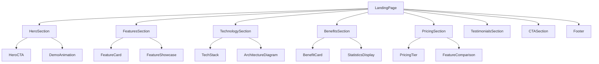
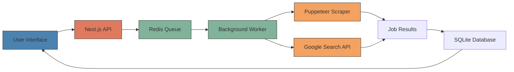

# Landing Page Design for Job Search Analyzer SaaS

## Overview

This design document outlines the landing page for the Job Search Analyzer, a comprehensive job search automation platform that revolutionizes how professionals discover and manage job opportunities. The landing page will showcase the platform's powerful features including automated job discovery, intelligent web scraping, real-time progress tracking, and advanced job management capabilities.

## Technology Stack & Dependencies

- **Frontend Framework**: Next.js 15 with App Router
- **Styling**: Tailwind CSS with custom color palette
- **Components**: React with TypeScript for type safety
- **Authentication**: NextAuth.js with Google OAuth
- **Performance**: Server-side rendering and static optimization
- **Responsive Design**: Mobile-first approach with Tailwind breakpoints

## Component Architecture

### Landing Page Component Hierarchy



### Hero Section Components

**HeroSection**
- Primary headline emphasizing automation and efficiency
- Compelling subheadline highlighting key benefits
- Animated background showing job search workflow
- Primary CTA button leading to sign-up/demo
- Secondary CTA for viewing live demo

**DemoAnimation**
- Interactive animation showing the search process
- Real-time progress indicators
- Visual representation of job discovery flow

### Features Section Components

**Core Features Showcase**

1. **Automated Job Discovery**
   - Google Custom Search API integration
   - Multi-platform job aggregation
   - Intelligent keyword matching
   - ATS platform targeting

2. **Real-Time Progress Tracking**
   - Live search status updates
   - Progress percentage indicators
   - Platform completion tracking
   - Result count updates

3. **Intelligent Web Scraping**
   - Puppeteer-powered automation
   - Content extraction and analysis
   - Company and location detection
   - Job type classification

4. **Advanced Job Management**
   - Collection creation and organization
   - Personal notes and ratings
   - Application status tracking
   - Priority level assignment

## Styling Strategy

### Color Palette

```css
:root {
  --primary-50: #eff6ff;
  --primary-500: #3b82f6;
  --primary-600: #2563eb;
  --primary-700: #1d4ed8;
  --primary-900: #1e3a8a;
  
  --accent-purple: #8b5cf6;
  --accent-green: #10b981;
  --accent-orange: #f59e0b;
  --neutral-gray: #6b7280;
}
```

### Typography Scale

- **Hero Headline**: 4xl-6xl font weight 800
- **Section Headers**: 3xl-4xl font weight 700
- **Feature Titles**: xl-2xl font weight 600
- **Body Text**: base-lg font weight 400
- **CTA Buttons**: lg font weight 600

### Component Styling

**Feature Cards**
- Rounded-xl borders with subtle shadows
- Gradient backgrounds for premium feel
- Hover animations with scale transforms
- Icon integration with consistent sizing

**CTA Buttons**
- Primary: Blue gradient with white text
- Secondary: White background with blue border
- Hover states with color transitions
- Consistent padding and border radius

## State Management

### Landing Page State

```typescript
interface LandingPageState {
  activeFeature: string | null;
  animationPlaying: boolean;
  userScrollPosition: number;
  ctaInteraction: {
    primaryClicks: number;
    secondaryClicks: number;
  };
}
```

### Feature Interaction State

```typescript
interface FeatureShowcaseState {
  selectedFeature: 'automation' | 'tracking' | 'scraping' | 'management';
  demoMode: boolean;
  animationStep: number;
}
```

## API Integration Layer

### Analytics Tracking

```typescript
interface LandingPageAnalytics {
  pageViews: number;
  ctaClicks: number;
  featureInteractions: Record<string, number>;
  scrollDepth: number;
  timeOnPage: number;
}
```

### A/B Testing Integration

```typescript
interface LandingPageVariant {
  id: string;
  name: string;
  heroMessage: string;
  ctaText: string;
  featureOrder: string[];
  conversionRate: number;
}
```

## Routing & Navigation

### Page Structure

```
/landing
├── /hero (scroll anchor)
├── /features (scroll anchor)
├── /technology (scroll anchor)
├── /benefits (scroll anchor)
├── /pricing (scroll anchor)
├── /testimonials (scroll anchor)
└── /contact (scroll anchor)
```

### Navigation Behavior

- Smooth scroll navigation between sections
- Fixed header with transparent background
- Mobile hamburger menu for responsive design
- Scroll-triggered animations for sections

## Content Architecture

### Hero Section Content

**Primary Headline**: "Automate Your Job Search with AI-Powered Discovery"

**Subheadline**: "Find your dream job faster with intelligent automation, real-time tracking, and comprehensive analytics. Let our platform do the heavy lifting while you focus on landing interviews."

**Key Value Propositions**:
- Save 10+ hours per week on job searching
- Access jobs from multiple ATS platforms simultaneously
- Get real-time updates on search progress
- Organize opportunities with smart collections

### Features Section Content

**Feature 1: Automated Job Discovery**
- Icon: Search automation symbol
- Title: "Intelligent Job Discovery"
- Description: "Leverage Google Custom Search API and intelligent scraping to find relevant opportunities across multiple platforms automatically."
- Benefits: 
  - Multi-platform aggregation
  - Keyword-based filtering
  - ATS platform targeting
  - Duplicate elimination

**Feature 2: Real-Time Progress Tracking**
- Icon: Progress indicator
- Title: "Live Search Monitoring"
- Description: "Watch your searches progress in real-time with detailed status updates and completion tracking."
- Benefits:
  - Live progress updates
  - Platform completion status
  - Result count tracking
  - Error handling alerts

**Feature 3: Intelligent Web Scraping**
- Icon: Web scraper symbol
- Title: "Advanced Content Extraction"
- Description: "Powered by Puppeteer automation, extract detailed job information including company data, requirements, and benefits."
- Benefits:
  - Comprehensive data extraction
  - Company information gathering
  - Location and job type detection
  - Content analysis and matching

**Feature 4: Smart Job Management**
- Icon: Organization symbol
- Title: "Organized Job Collections"
- Description: "Create custom collections, add personal notes, track application status, and prioritize opportunities."
- Benefits:
  - Custom collection creation
  - Personal notes and ratings
  - Application status tracking
  - Priority level management

### Technology Section Content

**Architecture Showcase**



**Technology Highlights**:
- Next.js 15 with App Router for optimal performance
- Redis-powered job queue for scalability
- Puppeteer automation for reliable scraping
- Google Custom Search API integration
- SQLite database for fast data access
- Docker containerization for consistency

### Benefits Section Content

**Quantifiable Benefits**

| Metric | Traditional Method | Job Search Analyzer | Improvement |
|--------|-------------------|-------------------|-------------|
| Time per search | 2-3 hours | 15 minutes | 88% reduction |
| Platform coverage | 1-2 sites | 10+ platforms | 500% increase |
| Job discovery rate | 20-30 jobs/day | 200+ jobs/day | 700% increase |
| Organization efficiency | Manual tracking | Automated collections | 95% improvement |

**User Benefits**:
- **Time Savings**: Reduce job search time by 88%
- **Comprehensive Coverage**: Access 10+ job platforms simultaneously
- **Better Organization**: Smart collections and tracking
- **Real-time Updates**: Never miss new opportunities
- **Data-Driven Decisions**: Analytics and matching insights

## Testing Strategy

### Component Testing

```typescript
describe('LandingPage Components', () => {
  it('renders hero section with correct messaging', () => {
    // Test hero component rendering
  });

  it('displays all feature cards with proper content', () => {
    // Test feature section rendering
  });

  it('handles CTA button interactions', () => {
    // Test button click events and navigation
  });

  it('responds correctly to mobile viewports', () => {
    // Test responsive design breakpoints
  });
});
```

### User Interaction Testing

```typescript
describe('User Interactions', () => {
  it('tracks analytics events correctly', () => {
    // Test analytics integration
  });

  it('navigates between sections smoothly', () => {
    // Test scroll navigation
  });

  it('handles form submissions properly', () => {
    // Test contact forms and CTAs
  });
});
```

### Performance Testing

- Page load time optimization (target: <2 seconds)
- Image optimization and lazy loading
- Critical CSS inlining
- JavaScript bundle size optimization
- Mobile performance metrics

## Conversion Optimization

### A/B Testing Elements

**Hero Section Variants**:
- Headline messaging variations
- CTA button text and colors
- Value proposition emphasis
- Demo video vs. static imagery

**Feature Section Variants**:
- Feature ordering and priority
- Visual presentation styles
- Technical vs. benefit-focused content
- Interactive vs. static demonstrations

### Analytics Tracking

**Key Metrics**:
- Conversion rate from landing to signup
- Feature interaction rates
- Scroll depth and engagement
- CTA click-through rates
- Mobile vs. desktop performance

**Event Tracking**:
```typescript
interface LandingPageEvents {
  heroCtaClick: { buttonType: 'primary' | 'secondary' };
  featureInteraction: { featureName: string; interactionType: string };
  scrollDepth: { percentage: number; section: string };
  formSubmission: { formType: string; success: boolean };
}
```

## Accessibility Implementation

### WCAG 2.1 AA Compliance

**Visual Design**:
- Color contrast ratios exceeding 4.5:1
- Focus indicators for keyboard navigation
- Scalable text up to 200% without horizontal scrolling
- Alternative text for all images and icons

**Interaction Design**:
- Keyboard navigation support
- Screen reader compatibility
- Semantic HTML structure
- ARIA labels and descriptions

**Content Structure**:
- Logical heading hierarchy (h1 → h2 → h3)
- Descriptive link text
- Form field labels and error messages
- Skip navigation links

## Mobile-First Responsive Design

### Breakpoint Strategy

```css
/* Mobile First Approach */
.container {
  @apply px-4 mx-auto;
}

/* Tablet - 768px and up */
@media (min-width: 768px) {
  .container {
    @apply px-6 max-w-4xl;
  }
}

/* Desktop - 1024px and up */
@media (min-width: 1024px) {
  .container {
    @apply px-8 max-w-6xl;
  }
}

/* Large Desktop - 1280px and up */
@media (min-width: 1280px) {
  .container {
    @apply px-12 max-w-7xl;
  }
}
```

### Mobile Optimizations

**Touch Interactions**:
- Minimum 44px touch targets
- Swipe gestures for feature carousel
- Pull-to-refresh functionality
- Touch-friendly button spacing

**Performance**:
- Progressive image loading
- Reduced animation complexity
- Optimized font loading
- Compressed asset delivery

## SEO Strategy

### Technical SEO

```html
<head>
  <title>Job Search Analyzer - Automate Your Job Discovery with AI</title>
  <meta name="description" content="Revolutionize your job search with AI-powered automation. Find opportunities across 10+ platforms, track progress in real-time, and organize results intelligently." />
  <meta name="keywords" content="job search automation, AI job finder, career platform, job scraping, automated job discovery" />
  
  <!-- Open Graph -->
  <meta property="og:title" content="Job Search Analyzer - AI-Powered Job Discovery" />
  <meta property="og:description" content="Save 10+ hours per week with automated job searching across multiple platforms." />
  <meta property="og:image" content="/og-image.jpg" />
  
  <!-- Schema Markup -->
  <script type="application/ld+json">
  {
    "@context": "https://schema.org",
    "@type": "SoftwareApplication",
    "name": "Job Search Analyzer",
    "description": "AI-powered job search automation platform",
    "category": "BusinessApplication"
  }
  </script>
</head>
```

### Content SEO

**Target Keywords**:
- Primary: "job search automation", "AI job finder"
- Secondary: "automated job discovery", "job search platform"
- Long-tail: "how to automate job searching", "best job search automation tools"

**Content Strategy**:
- Feature-rich descriptions with target keywords
- Benefit-focused headlines and subheadings
- Social proof and testimonials
- FAQ section addressing common queries