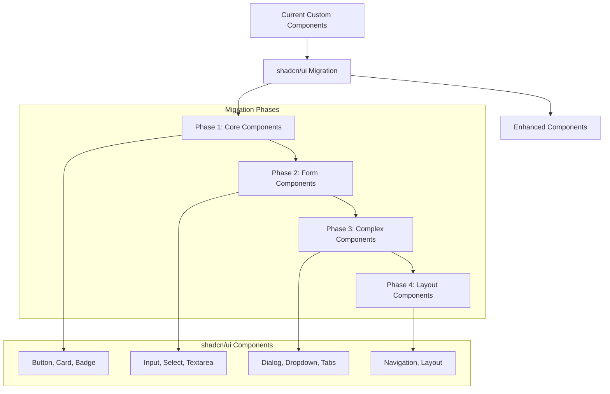
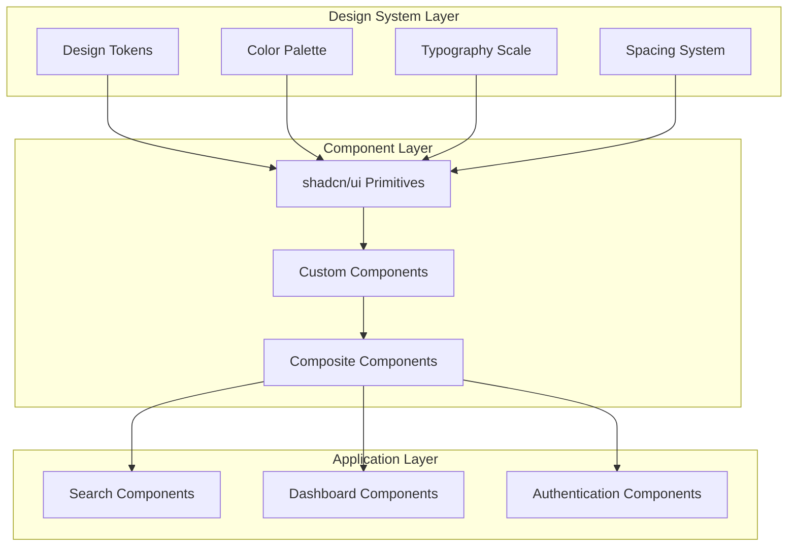
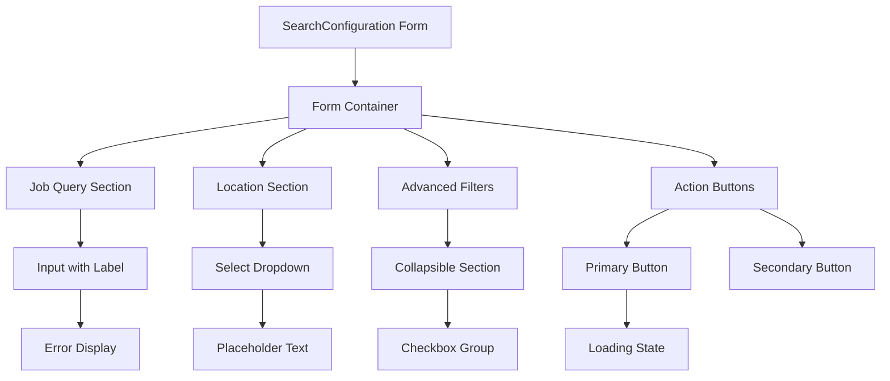
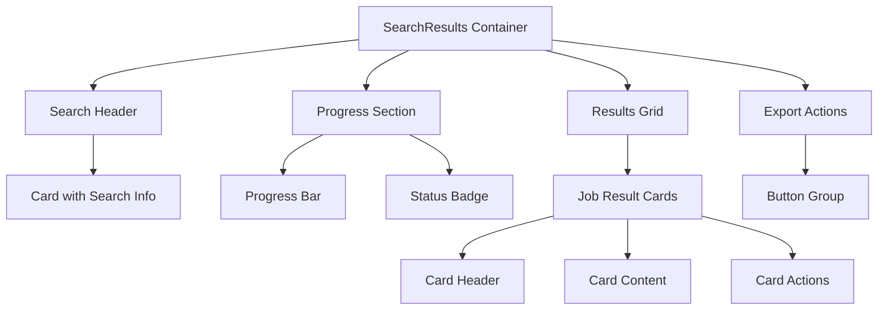
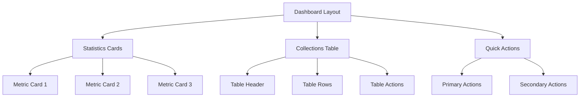

# shadcn/ui Integration Design

## Overview

This design outlines the integration of shadcn/ui as the primary component library and styling pattern for the job search automation platform. The integration will replace current custom components with shadcn/ui components while maintaining existing functionality and improving design consistency, accessibility, and developer experience.

### Goals
- Establish shadcn/ui as the main component library
- Improve design consistency across the application
- Enhance accessibility and user experience
- Reduce custom component maintenance overhead
- Maintain existing functionality during migration
- Leverage Tailwind CSS utility-first approach

### Scope
- Component library migration from custom components to shadcn/ui
- Styling system update to align with shadcn/ui patterns
- Form components enhancement with improved validation
- Dashboard and search interface redesign
- Theme configuration and design tokens setup

## Technology Stack Integration

### Current Stack Analysis
- **Frontend**: Next.js 15 with React 18.3.1
- **Styling**: Tailwind CSS 3.4.14 with custom configuration
- **Forms**: React Hook Form 7.53.0 with Zod validation
- **Icons**: Lucide React 0.446.0
- **UI Libraries**: Headless UI 2.1.9, Sonner 1.5.0

### shadcn/ui Stack Additions
- **shadcn/ui CLI**: Latest version for component installation
- **Radix UI Primitives**: Underlying component primitives
- **class-variance-authority**: Component variant management
- **tailwind-merge**: Tailwind class merging utility
- **Enhanced Tailwind Configuration**: CSS variables and design tokens

## Architecture

### Component Migration Strategy



### Component Mapping

| Current Component | shadcn/ui Component | Enhancement |
|------------------|-------------------|-------------|
| Custom Buttons | Button | Consistent variants, loading states |
| Form Inputs | Input, Textarea, Select | Better validation display |
| Modal Components | Dialog | Improved accessibility |
| Loading States | Skeleton | Better loading experience |
| Navigation | NavigationMenu | Enhanced keyboard navigation |
| Status Indicators | Badge | Consistent status colors |
| Cards | Card | Improved layout patterns |
| Tables | Table | Better responsive design |

### Design System Architecture



## Implementation Plan

### Phase 1: Foundation Setup

#### 1.1 shadcn/ui Installation
```bash
npx shadcn-ui@latest init
```

#### 1.2 Configuration Updates
- Update `tailwind.config.js` with shadcn/ui configuration
- Add CSS variables for theme customization
- Configure component aliases and paths

#### 1.3 Core Component Installation
```bash
npx shadcn-ui@latest add button
npx shadcn-ui@latest add card
npx shadcn-ui@latest add badge
npx shadcn-ui@latest add skeleton
```

### Phase 2: Form Components Migration

#### 2.1 Form Component Installation
```bash
npx shadcn-ui@latest add input
npx shadcn-ui@latest add textarea
npx shadcn-ui@latest add select
npx shadcn-ui@latest add label
npx shadcn-ui@latest add form
```

#### 2.2 SearchConfiguration Component Enhancement
- Replace custom form inputs with shadcn/ui components
- Improve validation error display
- Add consistent spacing and typography
- Enhance accessibility with proper labeling

#### 2.3 Form Validation Integration
- Integrate shadcn/ui Form component with React Hook Form
- Enhance error message display
- Add loading states for form submission

### Phase 3: Complex Components Migration

#### 3.1 Dialog and Navigation Components
```bash
npx shadcn-ui@latest add dialog
npx shadcn-ui@latest add dropdown-menu
npx shadcn-ui@latest add navigation-menu
npx shadcn-ui@latest add tabs
```

#### 3.2 SearchResults Component Enhancement
- Replace custom cards with shadcn/ui Card components
- Improve loading states with Skeleton components
- Add consistent spacing and layout patterns
- Enhance export functionality UI

#### 3.3 Dashboard Components Migration
- Upgrade SavedResults dashboard with shadcn/ui components
- Implement consistent table layouts
- Add improved pagination and filtering UI
- Enhance collection management interface

### Phase 4: Layout and Theme Customization

#### 4.1 Layout Components
```bash
npx shadcn-ui@latest add separator
npx shadcn-ui@latest add scroll-area
npx shadcn-ui@latest add sheet
```

#### 4.2 Theme Configuration
- Define custom color palette aligned with job search domain
- Configure typography scale for content hierarchy
- Set up spacing system for consistent layouts
- Add dark mode support

## Component Specifications

### Enhanced SearchConfiguration Component



#### Key Features
- Consistent form layout with shadcn/ui Form component
- Enhanced error messaging with proper styling
- Improved accessibility with proper labeling
- Loading states for form submission
- Responsive design for mobile devices

### Enhanced SearchResults Component



#### Key Features
- Consistent card layouts for job results
- Enhanced progress indicators
- Improved status badges with consistent colors
- Better loading states with skeleton components
- Responsive grid layout for different screen sizes

### Enhanced Dashboard Component



#### Key Features
- Consistent dashboard layout with shadcn/ui components
- Enhanced table design with proper spacing
- Improved action buttons with consistent styling
- Better data visualization with metric cards

## Design System Configuration

### Color Palette
```css
:root {
  --background: 0 0% 100%;
  --foreground: 222.2 84% 4.9%;
  --card: 0 0% 100%;
  --card-foreground: 222.2 84% 4.9%;
  --popover: 0 0% 100%;
  --popover-foreground: 222.2 84% 4.9%;
  --primary: 221.2 83.2% 53.3%;
  --primary-foreground: 210 40% 98%;
  --secondary: 210 40% 96%;
  --secondary-foreground: 222.2 84% 4.9%;
  --muted: 210 40% 96%;
  --muted-foreground: 215.4 16.3% 46.9%;
  --accent: 210 40% 96%;
  --accent-foreground: 222.2 84% 4.9%;
  --destructive: 0 84.2% 60.2%;
  --destructive-foreground: 210 40% 98%;
  --border: 214.3 31.8% 91.4%;
  --input: 214.3 31.8% 91.4%;
  --ring: 221.2 83.2% 53.3%;
  --radius: 0.5rem;
}
```

### Typography Scale
- **Headings**: Clear hierarchy with consistent spacing
- **Body Text**: Optimal readability for job descriptions
- **Labels**: Consistent styling for form elements
- **Captions**: Secondary information display

### Component Variants

#### Button Variants
- **Primary**: Main actions (Search, Save, Export)
- **Secondary**: Supporting actions (Cancel, Reset)
- **Destructive**: Delete operations
- **Ghost**: Subtle actions
- **Link**: Navigation elements

#### Badge Variants
- **Default**: General status indicators
- **Success**: Completed searches
- **Warning**: Processing status
- **Error**: Failed operations
- **Info**: Informational badges

## Migration Strategy

### Phase-by-Phase Migration

#### Week 1-2: Foundation
- Install and configure shadcn/ui
- Set up design system tokens
- Migrate core components (Button, Card, Badge)
- Update Tailwind configuration

#### Week 3-4: Forms
- Migrate SearchConfiguration component
- Enhance form validation display
- Improve user input experience
- Add loading states

#### Week 5-6: Complex Components
- Migrate SearchResults component
- Enhance Dashboard components
- Improve navigation and dialogs
- Add consistent layouts

#### Week 7-8: Polish and Testing
- Theme customization
- Accessibility improvements
- Performance optimization
- Cross-browser testing

### Compatibility Considerations
- Maintain existing API integrations
- Preserve current functionality
- Ensure responsive design
- Support existing user workflows

## Testing Strategy

### Component Testing
- Visual regression testing for UI components
- Accessibility testing with screen readers
- Cross-browser compatibility testing
- Responsive design testing

### Integration Testing
- Form submission workflows
- Search result display
- Dashboard functionality
- Navigation and routing

### Performance Testing
- Bundle size analysis
- Runtime performance
- Loading time optimization
- Memory usage monitoring

## Accessibility Enhancements

### Keyboard Navigation
- Consistent tab order
- Proper focus management
- Keyboard shortcuts for common actions

### Screen Reader Support
- Semantic HTML structure
- Proper ARIA labels
- Descriptive error messages
- Status announcements

### Visual Accessibility
- Sufficient color contrast
- Clear visual hierarchy
- Consistent iconography
- Scalable text sizing

## Performance Optimization

### Bundle Size Optimization
- Tree-shaking for unused components
- Code splitting for large components
- Lazy loading for non-critical components

### Runtime Performance
- Efficient re-rendering with React.memo
- Optimized state management
- Debounced user interactions

### Loading Experience
- Skeleton loading states
- Progressive enhancement
- Optimistic UI updates